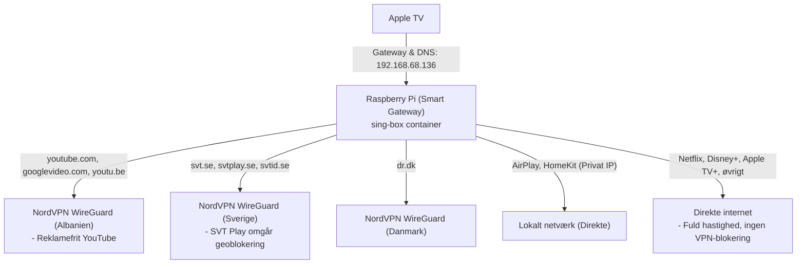

# Smart VPN Gateway til Apple TV

Dette repository indeholder en transparent, intelligent VPN-gateway til Raspberry Pi (og andre Linux-enheder) med NordVPN WireGuard (NordLynx).

Opsætningen gør, at dit Apple TV automatisk dirigerer specifikke streamingtjenester gennem relevante lande via VPN – **helt uden brug af apps på Apple TV'et**, og uden at påvirke almindelig streaming.

---

## 1. Sådan fungerer det (Trafikflow)

Der kører **én enkelt Docker-container** (`smart-gateway` baseret på `sing-box`), som fungerer som en intelligent trafikbetjent for dit Apple TV:



---

## 2. Projektstruktur

Projektet er helt simpelt og består af få filer:

```text
├── docker-compose.yml              # Starter Smart Gateway containeren (sing-box)
├── config.example.json             # Skabelon for konfigurationen (uden private nøgler)
├── config.json                     # Din aktive konfiguration (bliver genereret, udeladt fra git)
├── generate-nordvpn-configs.py     # Henter NordVPN nøgler og opretter config.json automatisk
├── setup.sh                        # 1-klik installationsscript til nye enheder
└── README.md                       # Denne vejledning
```

---

## 3. Hurtig installation på en ny enhed (f.eks. Pi 3 eller Pi 4)

Kør blot følgende 3 kommandoer i terminalen:

```bash
git clone https://github.com/cccp200/smart-vpn-gateway.git
cd smart-vpn-gateway
./setup.sh
```

Scriptet:
1. Installerer automatisk Docker og Docker Compose, hvis det mangler.
2. Aktiverer permanent IP-forwarding i Linux-kernen.
3. Beder om dit NordVPN Access Token og genererer automatisk `config.json`.
4. Starter gatewayen via `docker compose up -d`.

---

## 4. Konfiguration af dit Apple TV

På dit Apple TV skal du **ikke** installere nogen apps. Du ændrer blot netværksindstillingerne én gang:

1. Åbn **Indstillinger** (*Settings*) på Apple TV.
2. Gå til **Netværk** (*Network*) $\rightarrow$ Vælg dit netværk (**Wi-Fi** eller **Ethernet**).
3. Vælg **Konfigurer IP** (*Configure IP*) $\rightarrow$ Skift fra *Automatisk* til **Manuelt**:
   - **IP-adresse:** Behold Apple TV'ets nuværende IP (f.eks. `192.168.68.xxx`).
   - **Undernetmaske:** `255.255.255.0`
   - **Router (Gateway):** Din Raspberry Pi's IP-adresse (f.eks. `192.168.68.136`).
4. Vælg **Konfigurer DNS** (*Configure DNS*) $\rightarrow$ Skift fra *Automatisk* til **Manuelt**:
   - **DNS-server:** Din Raspberry Pi's IP-adresse (f.eks. `192.168.68.136`).
5. Gem og afslut.

---

## 5. Vigtig anbefaling: Faste IP-adresser på Routeren

Da Apple TV har Raspberry Pi'ens IP-adresse indtastet som fast gateway:

> [!IMPORTANT]
> **Reserver Raspberry Pi'ens IP-adresse i din router:**
> Hvis routeren genstarter og giver Raspberry Pi'en en anden IP, mister dit Apple TV internetforbindelsen.
>
> **Reserver også Apple TV'ets IP-adresse i routeren:**
> Da Apple TV nu kører med manuel IP, forhindrer en DHCP-reservation, at routeren ved en fejl tildeler samme IP-adresse til en anden enhed på netværket.

*Tip for TP-Link Deco brugere:*
- Åbn **Deco-appen** $\rightarrow$ **Mere** (*More*) $\rightarrow$ **Avanceret** (*Advanced*) $\rightarrow$ **Adressedefinition / Reservation** (*Address Reservation*).
- Tilføj både **Raspberry Pi** og **Apple TV**.

---

## 6. Daglige kommandoer

### Se live trafiklogs (her kan du se, hvilken VPN der vælges i realtid):
```bash
docker compose logs -f
```

### Genstart gatewayen:
```bash
docker compose restart
```

### Stop gatewayen:
```bash
docker compose down
```

### Tilføj et nyt domæne eller streamingtjeneste:
1. Rediger `config.json`.
2. Tilføj domænet under `domain_suffix` for det ønskede land under `rules`.
3. Genstart containeren: `docker compose restart`.
