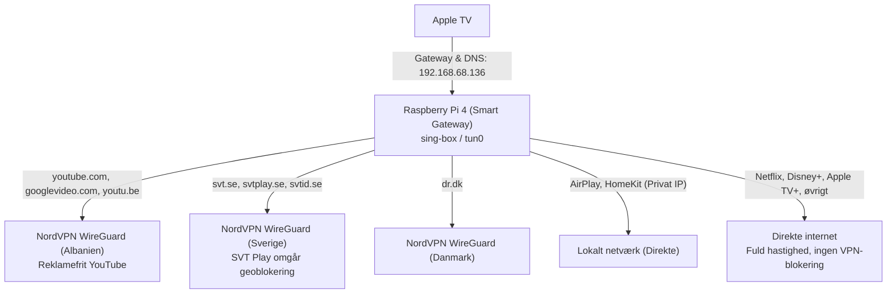

# Smart VPN Gateway & WireGuard Opsætning til Apple TV

Denne dokumentation beskriver den komplette opsætning af Raspberry Pi 4 som en transparent, intelligent VPN-gateway for Apple TV med NordVPN WireGuard (NordLynx).

---

## 1. Systemoversigt og Arkitektur

Formålet med denne opsætning er, at Apple TV automatisk dirigerer specifikke streamingtjenester gennem relevante lande via VPN – **helt uden brug af apps på Apple TV'et**, og uden at påvirke almindelig streaming.

### Trafikflow



---

## 2. Hvad der er installeret på Raspberry Pi'en

1. **Styresystem & Netværkskerne:**
   - **OS:** Debian GNU/Linux 13 (trixie), aarch64 (Raspberry Pi 4).
   - **IP-adresse:** `192.168.68.136` (på `wlan0`).
   - **WireGuard kernemodul:** Indlæst i Linux-kernen.
   - **IP Forwarding:** Slået til og gjort permanent i `/etc/sysctl.d/99-ip-forward.conf`:
     ```ini
     net.ipv4.ip_forward = 1
     ```

2. **Docker & Docker Compose:**
   - **Docker Engine:** `v29.9.1` (Community Edition).
   - **Docker Compose:** `v5.6.0`.
   - Brugeren `cp` er tilføjet til gruppen `docker`.
   - `docker.service` er aktiveret og starter automatisk ved systemboot.

3. **Smart Gateway (sing-box):**
   - Kører som container via Docker i mappen [`/home/cp/wireguard/smart-gateway/`](file:///home/cp/wireguard/smart-gateway).
   - Opretter et virtuelt `tun0`-interface med `auto_redirect: true` og `hijack-dns`.
   - Forbindes direkte til NordVPN's WireGuard-servere i Albanien, Danmark og Sverige.
   - Sniffer automatisk SNI (domæner) på HTTPS-trafik og dirigerer pakker efter regelsættet.

4. **Konfigurations- og Hjælpescripts:**
   - [`/home/cp/wireguard/generate-nordvpn-configs.py`](file:///home/cp/wireguard/generate-nordvpn-configs.py): Python-script, der automatisk kontakter NordVPN API via et Access Token, udtrækker `nordlynx_private_key`, finder de hurtigste servere for Albanien, Danmark og Sverige, og opdaterer konfigurationsfilerne.

---

## 3. Mappestruktur og Filer

Projektet er placeret i [`/home/cp/wireguard/`](file:///home/cp/wireguard):

```text
/home/cp/wireguard/
├── README.md                           # Denne dokumentation
├── docker-compose.yml                  # Original opsætning til 3 separate WireGuard containere
├── generate-nordvpn-configs.py         # Automatisk konfigurationsgenerator fra NordVPN token
├── config/                             # Konfigurationsfiler til separate WireGuard containere
│   ├── albanien/wg0.conf
│   ├── danmark/wg0.conf
│   └── sverige/wg0.conf
└── smart-gateway/                      # DEN AKTIVE SMART GATEWAY TIL APPLE TV
    ├── docker-compose.yml              # Docker Compose for sing-box containeren
    └── config.json                     # Routing-regler, DNS og WireGuard endpoints
```

---

## 4. Konfiguration af Apple TV

På dit Apple TV skal du **ikke** installere nogen apps. Du ændrer blot netværksindstillingerne én gang:

1. Åbn **Indstillinger** (*Settings*) på Apple TV.
2. Gå til **Netværk** (*Network*) $\rightarrow$ Vælg dit netværk (**Wi-Fi** eller **Ethernet**).
3. Vælg **Konfigurer IP** (*Configure IP*) $\rightarrow$ Skift fra *Automatisk* til **Manuelt**:
   - **IP-adresse:** Behold Apple TV'ets nuværende IP (f.eks. `192.168.68.xxx`).
   - **Undernetmaske:** `255.255.255.0`
   - **Router (Gateway):** **`192.168.68.136`** *(Raspberry Pi)*
4. Vælg **Konfigurer DNS** (*Configure DNS*) $\rightarrow$ Skift fra *Automatisk* til **Manuelt**:
   - **DNS-server:** **`192.168.68.136`** *(Raspberry Pi)*
5. Gem og afslut.

---

## 5. Vigtig anbefaling: Faste IP-adresser på Routeren

Da Apple TV har `192.168.68.136` indtastet fast som gateway:

> [!IMPORTANT]
> **Reserver Raspberry Pi'ens IP-adresse i din router:**
> Hvis routeren genstarter og giver Raspberry Pi'en en anden IP (f.eks. `192.168.68.150`), mister dit Apple TV internetforbindelsen.
>
> **Reserver også Apple TV'ets IP-adresse i routeren:**
> Da Apple TV nu kører med manuel IP, forhindrer en DHCP-reservation, at routeren ved en fejl tildeler den samme IP-adresse til en anden enhed på netværket.

*Tip:* Hvis du bruger **TP-Link Deco** (som standard bruger `192.168.68.x`):
- Åbn **Deco-appen** $\rightarrow$ **Mere** (*More*) $\rightarrow$ **Avanceret** (*Advanced*) $\rightarrow$ **Adressedefinition / Reservation** (*Address Reservation*).
- Tilføj både **Raspberry Pi** og **Apple TV**.

---

## 6. Drift, Overvågning og Kommandoer

### Se live routing-logs
Du kan se trafikken i realtid, når du bruger Apple TV:
```bash
cd /home/cp/wireguard/smart-gateway
sudo docker compose logs -f
```

### Genstart gatewayen
```bash
cd /home/cp/wireguard/smart-gateway
sudo docker compose restart
```

### Stop gatewayen (hvis du midlertidigt vil slå den fra)
```bash
cd /home/cp/wireguard/smart-gateway
sudo docker compose down
```

### Tilføj et nyt domæne eller en ny app
Hvis du vil have en ny tjeneste dirigeret gennem en bestemt VPN:
1. Rediger [`/home/cp/wireguard/smart-gateway/config.json`](file:///home/cp/wireguard/smart-gateway/config.json).
2. Tilføj domænet under `domain_suffix` for det ønskede land i `rules`-sektionen.
3. Genstart containeren:
   ```bash
   cd /home/cp/wireguard/smart-gateway && sudo docker compose restart
   ```

### Opdatering af NordVPN Token i fremtiden
Hvis dit token på et tidspunkt udløber, eller du vil hente nye anbefalede servere fra NordVPN:
```bash
cd /home/cp/wireguard
python3 generate-nordvpn-configs.py
cd /home/cp/wireguard/smart-gateway
sudo docker compose restart
```
Scriptet henter automatisk friske nøgler og opdaterer både `config.json` og `wg0.conf`-filerne.
